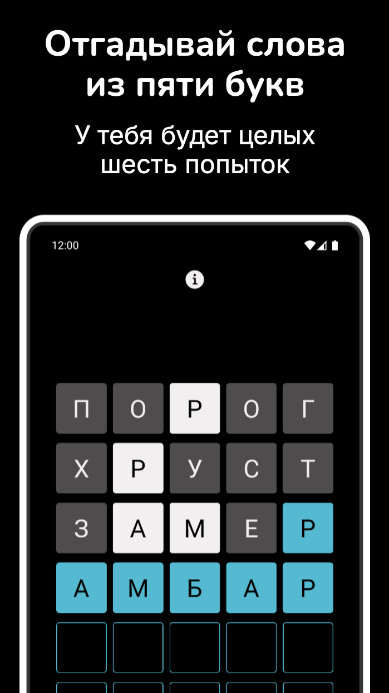
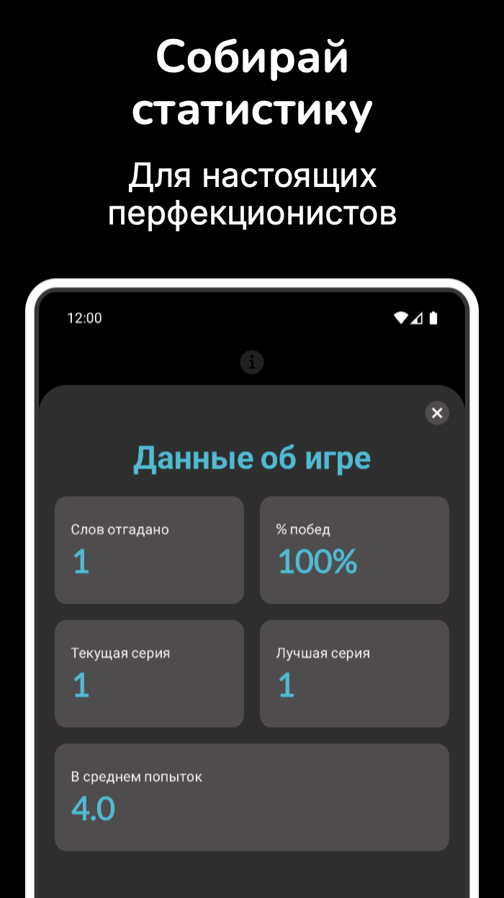
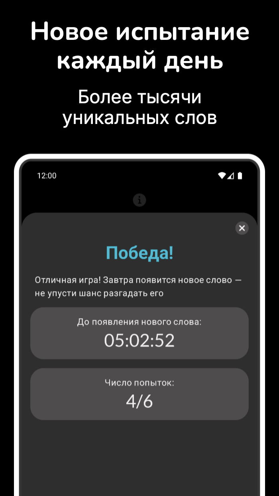

# WordMe

Guess the 5-letter word in 6 tries — just like Wordle, but in Russian! WordMe is a word puzzle where every guess sharpens your thinking and expands your vocabulary.

The WordMe app invites you to put your wits to the test every day. The game shows which letters you've guessed correctly and where you went wrong, keeping your mind sharp with WordMe!

  

## Tech Stack

WordMe is built with a modern Android development toolkit focused on performance, reliability, and modularity.  
Below is the complete technology stack, sorted by decreasing importance:

### 1. Kotlin  
Primary language used across the entire codebase for expressive, safe, and maintainable development.

### 2. Jetpack Compose  
Modern declarative UI toolkit powering all interface components and animations.

### 3. Custom Backend (Ktor)
WordMe uses a **custom backend built with Ktor**.

The backend is responsible for:
- Providing the daily word and game metadata
- Centralized API logic and access control

The server is fully open-source and available here:  
👉 **https://github.com/merail/wordme-server**

### 4. Firebase Services  
A robust backend foundation leveraging multiple Firebase products:
- Firebase Analytics – usage insights
- Firebase Crashlytics – real-time crash reporting
- Firebase Auth – secure anonymous authentication

### 5. Hilt  
Dependency injection framework simplifying component wiring and improving testability.

### 6. Jetpack Navigation (2.8+)  
Modern navigation framework enabling type-safe routes and structured app flows.

### 7. DataStore  
Local persistence layer built on Jetpack DataStore for lightweight, type-safe storage of game state, statistics, and preferences.

### 8. Baseline Profiles  
Optimizes app startup and runtime performance on Android devices.

### 9. Unit & Instrumentation Tests  
- MockK for unit-test mocking  
- Full instrumentation test suite (Espresso + UI Automator) to validate UI and runtime behavior

### 10. Gradle Convention Plugins  
Custom Gradle plugins centralizing build logic for cleaner, maintainable module configuration.

### 11. SplashScreen API  
Native Android API providing a smooth, consistent launch experience across devices.

---

## Architecture Overview

- **Android App**
  - Clean, modular architecture
  - Offline-first approach using DataStore
  - Declarative UI with Compose

- **Backend**
  - Ktor-based REST API
  - Self-hosted
  - Public GitHub repository

---

## Links

- 📱 **Android App:** https://www.rustore.ru/catalog/app/merail.life.wordme
- 🖥️ **Backend (Ktor):** https://github.com/merail/wordme-server

## License

This project is licensed under the MIT License.  
See the [LICENSE](LICENSE) file for details.
